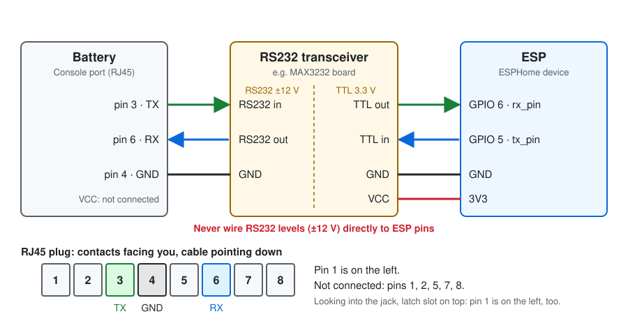

<!-- Improved compatibility of back to top link: See: https://github.com/othneildrew/Best-README-Template/pull/73 -->
<a id="readme-top"></a>

<!-- PROJECT SHIELDS -->
[![Contributors][contributors-shield]][contributors-url]
[![Forks][forks-shield]][forks-url]
[![Stargazers][stars-shield]][stars-url]
[![Issues][issues-shield]][issues-url]
[![project_license][license-shield]][license-url]
<br />
<h1 align="center">Pytes E-Box <sup>WIP</sup></h1>
<p align="center">
  ESPHome component for Pytes &amp; Pylontech batteries — pluggable driver architecture.
</p>

`pytes_e_box` is an ESPHome external component that pulls live data from
Pytes / Pylontech-family batteries over the **UART console port** and exposes
voltage, current, temperatures, SoC, per-cell values and status text as ESPHome
sensors / text sensors.

It uses a small pluggable driver layer, so a single component supports several
protocol variants (E-Box, LV1 stack, Pylontech, …) selected via a `type:` field.


Installation
------------

Add the component to your device YAML as an external component:

```yaml
external_components:
  - source: github://oxynatOr/esphome-pytes_e_box
    components: [ pytes_e_box ]
    refresh: 1d
```

To test a branch before it is merged, pin it with `@<branch>` and set
`refresh: 0s` so ESPHome always pulls the latest commit:

```yaml
external_components:
  - source: github://oxynatOr/esphome-pytes_e_box@<branch>
    components: [ pytes_e_box ]
    refresh: 0s
```


Hardware Setup
--------------

Connect to the port labeled ***Console*** on the master battery. Any existing
CAN or RS485 connections (e.g. to an inverter) are untouched and keep working.
The CAN and RS485 ports are RJ45 jacks too, so check the label first.

The console port is a **RS232** interface on an RJ45 connector. RS232 uses
about ±12 V and is *not* TTL-compatible — a RS232 transceiver must sit between
the battery and the ESP. **MAX3232**-based transceivers have been tested and
work well. Never connect the RJ45 pins directly to an ESP pin.

In a stack, always wire to the **master** battery's console port; child
batteries are reached through it.



| Signal | RJ45 pin | Transceiver (RS232 side) | Transceiver (TTL side) | ESP |
| --- | --- | --- | --- | --- |
| Battery → ESP | ***3*** (battery TX) | RS232 in | TTL out | GPIO 6 (`rx_pin`) |
| ESP → Battery | ***6*** (battery RX) | RS232 out | TTL in | GPIO 5 (`tx_pin`) |
| Ground | ***4*** | GND | GND | GND |
| Power | ***NC*** | – | VCC | 3v3 |

Wire by the **function** in the table, not by the `RXD`/`TXD` labels on the
board: some boards label from the module's point of view, others from the
microcontroller's. If nothing arrives, swap the two data wires.

The UART must run at **115200 baud, 8N1** with both `tx_pin` and `rx_pin`
set. Other settings are rejected at config time.

Pin numbering, a checklist for "nothing arrives" and a complete device YAML
are in the [hardware guide](documentation/PCB.md).

### ESP32-S linker note

On ESP32-S (Xtensa) the linker fails when **13 or more** batteries are
configured. Adding the flag below makes the assembler emit per-function literal
pools inline in `.text`, keeping every load in range:

```yaml
esphome:
  platformio_options:
    build_flags:
      - -mtext-section-literals
```


Tested devices
--------------

| Manufacturer | Device                 | Driver (`type:`)  | Tested on hardware |
| ---          | ---                    | ---               | --- |
| Pytes        | E-BOX-48100R-C         | `pytes_e_box`     | ✅ |
| Pytes        | E-BOX-48100V-D (V5)    | `pytes_e_box`     | ✅ |
| Pytes        | E-BOX-48100R TE        | `pytes_e_box`     | ✅ |
| Pytes        | LV1 Stack Battery      | `pytes_lv1`       | parser only |
| Pylontech    | US2000 / US3000 family | `pylontech`       | parser only |

> "Parser only" means the driver is a faithful port of an existing
> implementation and compiles cleanly, but has not yet been verified against
> real hardware in this repo. Reports welcome.


Supported drivers
-----------------

Pick a driver with the `type:` field on the `pytes_e_box:` hub. If omitted,
`pytes_e_box` is used (fully backwards compatible).

| `type:`        | What it speaks                                                  |
| ---            | ---                                                             |
| `pytes_e_box`  | Default. Pytes E-Box console: `pwr`, `pwr N`, `bat N`.          |
| `pytes_lv1`    | Same as E-Box but with the LV1 cell-line column layout (per-cell current available). |
| `pylontech`    | Upstream Pylontech protocol: single `pwr` returns all batteries, one line each, with dynamic columns (Tlow.Id …). |
| `example`      | Tiny template driver — copy it to add a new BMS type.           |

Adding a new BMS is a matter of subclassing `BmsDriver` and registering the
type in three places. See [`components/pytes_e_box/example_driver.h`](components/pytes_e_box/example_driver.h)
for an annotated walkthrough.


Component / Hub
---------------

```yaml
pytes_e_box:
  - id: pvbatt
    type: pytes_e_box        # optional, default
    uart_id: uart01
    batteries: 2
    update_interval: 30s
    poll_timeout: 4s
    command_idle_time: 150ms
    max_retries: 2
    connected:
      name: "BMS Connected"
    error_count:
      name: "BMS Error Count"
    total_power:
      name: "Battery System Power"
```

### Configuration variables

- **id** (*Optional*): The id to use for this `pytes_e_box` component.
- **type** (*Optional*, default `pytes_e_box`): Which driver to use. One of
  `pytes_e_box`, `pytes_lv1`, `pylontech`, `example`.
- **uart_id** (*Optional*): The UART bus ID.
- **batteries** (***Required***): Number of batteries in the system. Range
  `1..16`.
- **update_interval** (*Optional*, default `15s`): How often to poll the
  battery.
- **poll_timeout** (***Required***): Maximum wait for the response to one
  command (e.g. `4s`).
- **command_idle_time** (*Optional*, default `150ms`): Idle delay between two
  commands.
- **max_retries** (*Optional*, default `2`): How often a command is resent
  after a timeout before the component moves on to the next one. Range
  `0..10`.

#### Diagnostic and system sensors

- **connected** (*Optional*): Binary sensor (`connectivity`). `on` as soon as
  the battery answers, `off` when a whole polling cycle got no answer at all.
  All options from [Binary Sensor](https://esphome.io/components/binary_sensor/#config-binary-sensor).
- **error_count** (*Optional*): Number of timeouts and unrecognized responses
  since boot (`total_increasing`, diagnostic).
- **total_current** (*Optional*): Sum of the current of all batteries, in A.
- **total_power** (*Optional*): Sum of the power of all batteries, in W.
- **average_soc** (*Optional*): Mean State of Charge of all batteries, in %.

The system sensors are published once per polling cycle. All accept the
standard ESPHome [sensor options](https://esphome.io/components/sensor/#config-sensor).


Sensor
------

All values are reported per battery and (where supported) per cell.

```yaml
# Example configuration entry
sensor:
  - platform: pytes_e_box
    pytes_e_box_id: pvbatt
    battery: 1
    voltage:
      name: "Battery 1 Voltage"
    current:
      name: "Battery 1 Current"
    coulomb:
      name: "Battery 1 State of Charge"
    cells:
      - cell: 1
        voltage:
          name: "Battery Cell 1.1 Voltage"
```

### Configuration variables

- **pytes_e_box_id** (***Required***): ID of the `pytes_e_box` hub when there
  is more than one.
- **battery** (***Required***): Which battery to expose. `1` is the master,
  `2..16` are child batteries.

#### Battery-level sensors

- **voltage** (*Optional*): Battery pack voltage, in V.
- **current** (*Optional*): Pack current, in A. Negative when discharging.
- **power** (*Optional*): Pack power (voltage x current), in W. Negative when
  discharging.
- **temperature** (*Optional*): Pack temperature, in °C.
- **temperature_low** / **temperature_high** (*Optional*): Historic min/max
  pack temperature, in °C.
- **voltage_low** / **voltage_high** (*Optional*): Voltage of the lowest /
  highest cell, in V.
- **coulomb** (*Optional*): State of Charge, in %.
- **soc_voltage** (*Optional*): SoC reference voltage (Pytes only), in V.
- **total_coulomb** (*Optional*): Total accumulated coulomb counter, in Ah
  (Pytes only).
- **real_coulomb** (*Optional*): Real coulomb counter, in Ah (Pytes only).
- **total_power_in** / **total_power_out** (*Optional*): Cumulative charge
  in / out, in Ah (Pytes only).
- **work_status** (*Optional*): Numeric work-status code (Pytes only).
- **cell_count** (*Optional*): Number of cells reported by the battery
  (Pytes only).
- **mos_temperature** (*Optional*): MOSFET temperature in °C (Pylontech only).
- **cell_voltage_min** / **cell_voltage_max** (*Optional*): Lowest / highest
  cell voltage of the last `bat N` readout, in V (Pytes only).
- **cell_voltage_delta** (*Optional*): Difference between highest and lowest
  cell, in V. A good indicator for cell balance (Pytes only).

All accept the standard ESPHome [sensor options](https://esphome.io/components/sensor/#config-sensor)
(filters, accuracy, device class, …).

#### Per-cell sensors

- **cells** (*Optional*): List of cells to expose.
  - **cell** (***Required***): Cell index, `0..15`.
  - **voltage** (*Optional*): Cell voltage, in V.
  - **current** (*Optional*): Cell current, in A. Only meaningful where the
    BMS reports per-cell current (e.g. `pytes_lv1`).
  - **temperature** (*Optional*): Cell temperature, in °C.
  - **coulomb** (*Optional*): Cell-level SoC, in %.


Text Sensor
-----------

```yaml
text_sensor:
  - platform: pytes_e_box
    pytes_e_box_id: pvbatt
    battery: 1
    base_state:
      id: bat1_base_state
      name: "Battery 1 Base State"
```

### Configuration variables

- **pytes_e_box_id** (***Required***): ID of the `pytes_e_box` hub.
- **battery** (***Required***): Which battery to expose (`1..16`).

#### Battery-level text sensors

- **base_state** (*Optional*): Usually `Dischg`, `Charge` or `Idle`.
- **voltage_state** / **current_state** / **temperature_state** (*Optional*):
  Usually `Normal`; goes to a warning/alarm string when out of range.
- **barcode** (*Optional*): Battery barcode (Pytes only).
- **dev_type** (*Optional*): Device model string (Pytes only).
- **firm_version** (*Optional*): Firmware version (Pytes only).
- **coulomb_status** / **bat_status** (*Optional*): Coulomb / battery status
  text (Pytes only).
- **cmos_status** / **dmos_status** (*Optional*): Charge- / discharge-MOSFET
  status text (Pytes only).
- **bat_protect_ena** / **pwr_protect_ena** (*Optional*): Enabled-protection
  bitmasks as text (Pytes only).
- **bat_events** / **power_events** / **system_fault** (*Optional*): Event /
  fault flags as text (Pytes only).
- **device_time** (*Optional*): Date and time of the battery clock, in the
  order the BMS prints it.
- **balance_voltage_state** / **balance_temperature_state** (*Optional*):
  Balancing state for voltage / temperature (`B.V.St` / `B.T.St` columns).

All accept the standard ESPHome
[text_sensor options](https://esphome.io/components/text_sensor/#config-text-sensor).

#### Per-cell text sensors

- **cells** (*Optional*):
  - **cell** (***Required***): Cell index, `0..15`.
  - **base_state**, **voltage_state**, **current_state**,
    **temperature_state** (*Optional*): Per-cell state strings.


Examples
--------

YAMLs in [`examples/`](examples/). The first three are **snippets** you add
to your own device YAML (together with the `external_components:` entry from
[Installation](#installation)); the next three are **complete device
configs** that load the component from the local `components/` folder.

Snippets:

- [`pytes_e_box-base-minimal.yaml`](examples/pytes_e_box-base-minimal.yaml) — smallest sensible config.
- [`pytes_e_box-base.yaml`](examples/pytes_e_box-base.yaml) — hub only, typical multi-battery setup.
- [`pytes_e_box-full.yaml`](examples/pytes_e_box-full.yaml) — every sensor exposed, using the packages below.

Complete configs:

- [`pytes_lv1.yaml`](examples/pytes_lv1.yaml) — Pytes LV1 stack with per-cell current.
- [`pylontech.yaml`](examples/pylontech.yaml) — Pylontech US2000/US3000 family.
- [`example-driver.yaml`](examples/example-driver.yaml) — template driver demo.

Home Assistant:

- [`ha-dashboard.yaml`](examples/ha-dashboard.yaml) — drop-in Home Assistant
  Lovelace dashboard for a 4-battery stack (built-in cards only, no HACS).

### Packages

The [`examples/packages/`](examples/packages/) folder contains reusable
package files, one include per battery:

| Package | Use it for |
| --- | --- |
| [`pytesebox-monitor.yaml`](examples/packages/pytesebox-monitor.yaml) | Every sensor of one battery, including all cells |
| [`pytesebox-monitor-sub-device.yaml`](examples/packages/pytesebox-monitor-sub-device.yaml) | The same, but each battery shows up as its own device in Home Assistant |

Include paths are relative to the YAML that includes them. From a file in
`examples/` that is `packages/pytesebox-monitor.yaml`, as in
[`pytes_e_box-full.yaml`](examples/pytes_e_box-full.yaml). From anywhere else,
use the GitHub form shown in the [hardware guide](documentation/PCB.md).

The sub-device package assigns every entity to `device_id: battery_<n>`, so
you have to declare those devices in your own YAML, one per battery:

```yaml
esphome:
  devices:
    - id: battery_1
      name: "Battery 1"
    - id: battery_2
      name: "Battery 2"
```


Notes & troubleshooting
-----------------------

- **Timeouts:** the log tells you which side is the problem.
  - `no bytes received - check RX wiring/pin/GND`: nothing arrives at the ESP
    at all. Check the transceiver, swapped RX/TX, GND and the `rx_pin`. A
    loopback test (bridge RX and TX on the ESP) shows whether the UART itself
    works.
  - `N bytes received but no terminator`: the battery answers, but the
    response is cut off or not recognized. Increase `poll_timeout` or check
    the `type:`.
- **Mixed magnitudes:** if one battery in a stack shows a very different
  current than the others, the raw value from the device differs (mixed
  firmware or per-battery scale). Use a per-battery filter rather than a
  shared one.
- **`pytes_lv1`** swaps the cell-line column order (`num volt curr tempr …`
  instead of `num volt tempr … curr`); the rest of the protocol is identical
  to `pytes_e_box`.
- **`pylontech`** sends one `pwr` and parses the streamed response without a
  terminator handshake — there is no `pwr N` / `bat N` and no per-cell data.


Upgrading from older versions
-----------------------------

- Battery and cell **current** are now published in **A** instead of mA.
  Remove any `multiply: 0.001` filter you added for that. Home Assistant
  switches the unit of the history once.
- `total_coulomb`, `real_coulomb`, `total_power_in` and `total_power_out` are
  now exact (no integer rounding), so the shown value can change slightly.
- The sensor `dev_datetime` was removed (it never got a value). Use the text
  sensor `device_time` instead.
- `name:` directly under `battery:` or `cell:` is no longer accepted; give
  each sensor its own `name:`.
- `command_idle_time` is now optional (default `150ms`).


<!-- LICENSE -->
## License

Distributed under the terms of the included [LICENSE](LICENSE) file.

<p align="right">(<a href="#readme-top">back to top</a>)</p>


<!-- MARKDOWN LINKS & IMAGES -->
[contributors-shield]: https://img.shields.io/github/contributors/oxynatOr/esphome-pytes_e_box.svg?style=for-the-badge
[contributors-url]: https://github.com/oxynatOr/esphome-pytes_e_box/graphs/contributors
[forks-shield]: https://img.shields.io/github/forks/oxynatOr/esphome-pytes_e_box.svg?style=for-the-badge
[forks-url]: https://github.com/oxynatOr/esphome-pytes_e_box/network/members
[stars-shield]: https://img.shields.io/github/stars/oxynatOr/esphome-pytes_e_box.svg?style=for-the-badge
[stars-url]: https://github.com/oxynatOr/esphome-pytes_e_box/stargazers
[issues-shield]: https://img.shields.io/github/issues/oxynatOr/esphome-pytes_e_box.svg?style=for-the-badge
[issues-url]: https://github.com/oxynatOr/esphome-pytes_e_box/issues
[license-shield]: https://img.shields.io/github/license/oxynatOr/esphome-pytes_e_box.svg?style=for-the-badge
[license-url]: https://github.com/oxynatOr/esphome-pytes_e_box/blob/main/LICENSE
