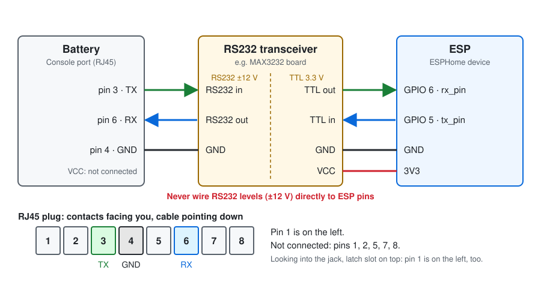
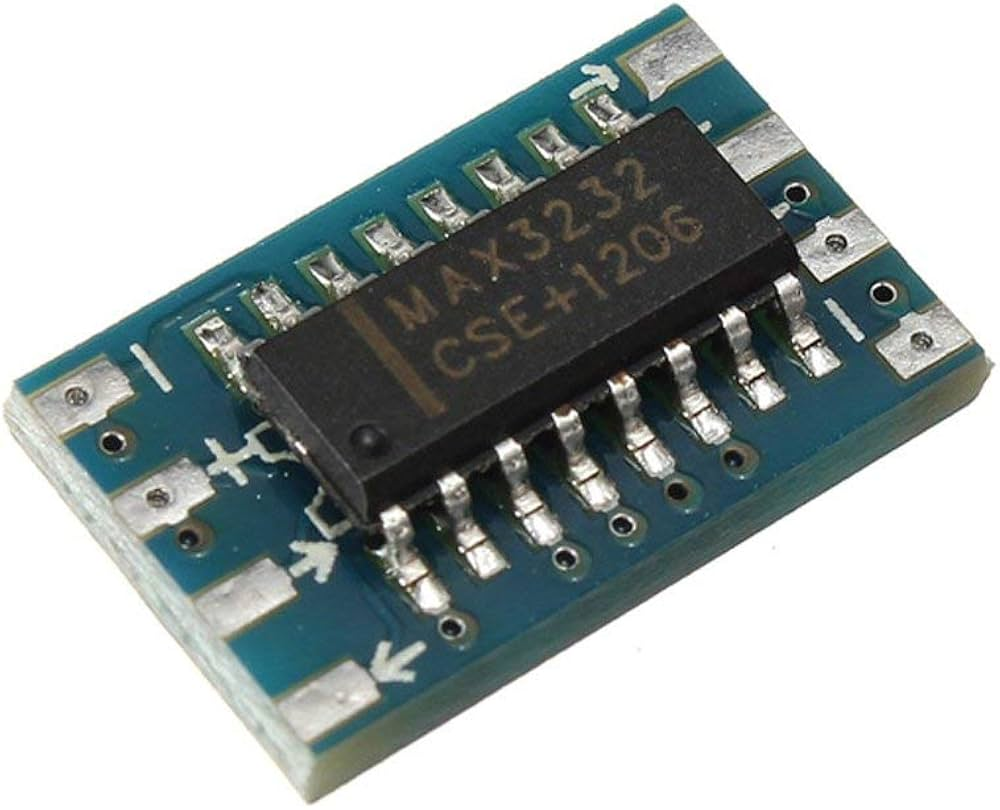

<a id="hardware-top"></a>

<h1 align="center">Pytes E-Box <sup>Hardware</sup></h1>
<p align="center">
  Wiring the battery console port to an ESP.
</p>

<p align="center">
  
</p>

[Back to the docs overview](README.md)


Console port
------------

Connect to the port labeled ***Console*** on the battery. Any existing CAN or
RS485 connections (e.g. to an inverter) are untouched and keep working.

> ⚠️ The CAN and RS485 ports are RJ45 jacks too. Double-check the label
> before you plug anything in.

The console port is a **RS232** interface on an RJ45 connector. RS232 uses
voltages of about ±12 V and is *not* TTL-compatible, so a RS232 transceiver
must sit between the battery and the ESP. **MAX3232**-based transceivers have
been tested and work well.

> ⚠️ Never connect the RJ45 pins directly to an ESP pin. The RS232 levels can
> destroy the GPIO.

> In a stack, always wire to the **master** battery's console port. Child
> batteries are reached through it.


Wiring
------



Only three wires go to the battery. The transceiver is powered from the ESP,
nothing is supplied by the battery.

| Signal | RJ45 pin | Transceiver (RS232 side) | Transceiver (TTL side) | ESP |
| --- | --- | --- | --- | --- |
| Battery → ESP | ***3*** (battery TX) | RS232 in | TTL out | GPIO 6 (`rx_pin`) |
| ESP → Battery | ***6*** (battery RX) | RS232 out | TTL in | GPIO 5 (`tx_pin`) |
| Ground | ***4*** | GND | GND | GND |
| Power | ***NC*** | – | VCC | 3v3 |

The GPIOs are only an example. Any free UART-capable pins work; set them as
`tx_pin` / `rx_pin` in the `uart:` block.

### Pin numbering

RJ45 pins are counted 1 to 8 from left to right when you look at the plug
with the contacts facing you and the cable pointing down. Looking into a jack
with the latch slot on top, pin 1 is on the left as well. This is the
standard numbering, but if in doubt, check the cable with a continuity tester
before you connect it.

> A ready-made "RJ45 to DB9" console cable is often wired differently from a
> plain patch cable. If you use one, measure which of its wires end up on
> pins 3, 4 and 6 first.

### Transceiver labels

Boards label their TTL pins differently. Some name them from the point of
view of the module, others from the point of view of the microcontroller, so
`RXD` and `TXD` can mean the opposite of what you expect. Wire by the
**function** in the table above: the TTL output goes to the ESP's `rx_pin`,
the TTL input to its `tx_pin`.



### Checklist if nothing arrives

The log tells you what is going on: `no bytes received - check RX wiring/pin/GND`
means nothing reaches the ESP at all.

- Swap the two data wires between transceiver and ESP. This is the most
  common mistake, because of the labels described above.
- GND of ESP, transceiver and battery is connected.
- The transceiver is powered with 3.3 V, not 5 V.
- The wires are on pins 3, 4 and 6 of the **Console** port.
- Loopback test: bridge RX and TX on the ESP side. With `debug:` enabled on
  the `uart:` bus you should see your own commands come back (`<<<`).


ESPHome setup
-------------

A complete device YAML for two batteries, using the per-battery package from
[`examples/packages/`](../examples/packages/):

```yaml
esphome:
  name: pytes-monitor

esp32:
  board: esp32-c3-devkitm-1

wifi:
  ap:

logger:

api:

ota:
  - platform: esphome

external_components:
  - source: github://oxynatOr/esphome-pytes_e_box
    components: [ pytes_e_box ]
    refresh: 1d

packages:
  pytes_ebox_1:
    url: https://github.com/oxynatOr/esphome-pytes_e_box
    files:
      - path: examples/packages/pytesebox-monitor.yaml
        vars:
          pytes_e_box_id: pvbatt
          battery_num: 1
          cell_prefix: "Cell"
          battery_prefix: "Battery"
  pytes_ebox_2:
    url: https://github.com/oxynatOr/esphome-pytes_e_box
    files:
      - path: examples/packages/pytesebox-monitor.yaml
        vars:
          pytes_e_box_id: pvbatt
          battery_num: 2
          cell_prefix: "Cell"
          battery_prefix: "Battery"

uart:
  id: uart01
  tx_pin: GPIO5
  rx_pin: GPIO6
  baud_rate: 115200
  rx_buffer_size: 1024

pytes_e_box:
  - id: pvbatt
    uart_id: uart01
    batteries: 2
    update_interval: 30s
    poll_timeout: 4s
    connected:
      name: "BMS Connected"
    error_count:
      name: "BMS Error Count"
```

All options are described in the
[configuration reference](../README.md#component--hub).


<p align="right">(<a href="#hardware-top">back to top</a>)</p>
